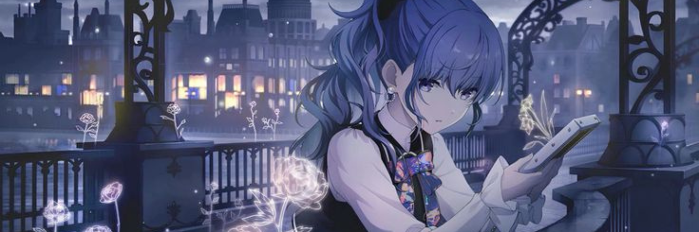
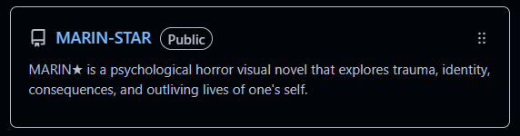
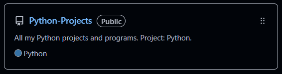

<!--
    MAFUYU ASAHINA × NIGHTCORD AT 25:00
    GitHub Profile README
    Palette:
    #8888CC — Mafuyu Wisteria
    #10111B — Midnight
    #191B2B — Deep Sekai
    #B8B8E8 — Lavender Mist
    #91A8D8 — Moonlight Blue
    #E4E4F0 — Soft Snow
-->

<!-- ✦ HEADER ✦ -->

<p align="center">
  
</p>

<p align="center">
  <sub>☾ ２５時、ナイトコードで。 ✦ 25:00 ✦</sub>
</p>

<h1 align="center">
  "I wonder what I really want to do..."
</h1>

<p align="center">
  
</p>

<p align="center">
  <i>「 眠れない夜に、音楽を。 」</i>
  <br>
  <sub>Nightcord at 25:00. ♡</sub>
</p>

<!-- ✦ ABOUT ME ✦ -->

## ☾  About Me

```text
⋆｡°✩ user: fritxfloriann ⋆｡°✩

⋆｡°✩ hobbies: technology, programming, writing, video games, and guitar. ✩°｡⋆

⋆｡°✩ status: steady pace ✩°｡⋆

⋆｡°✩ mood: always hungry ✩°｡⋆

୨ৎ currently coding in python. ୨ৎ

୨ৎ My beloved, Mafuyu Asahina. ୨ৎ
```

୨ৎ Hello World! Here is a short list for my introduction.

- ❄️  I make projects and do programming with Python soon to pursue C++!
 
- 🎧  Your local programmer in Python!
 
- 🌙  Active in the afternoons and evenings.
 
- 💻  Programmer, PC builder, tech enthusiast, and pursuing TAFE in IT.
 
- 🪻  Currently working on: `MARIN-STAR` and `Python-Projects`.

<sub>「 I wonder what I really want to do... 」</sub>

<!-- ✦ TECH STACK ✦ -->

## Tech Stack

<p align="center">
  ────────────୨ৎ────────────
</p>

<p align="center">
  
</p>

<p align="center">
  <sub>I'm still currently on Python. I will learn C++, JavaScript, HTML, and CSS in the future.</sub>
</p>

<p align="center">
  ────────────୨ৎ────────────
</p>

<!-- ✦ GITHUB STATS ✦ -->

## GitHub Statistics

<p align="center">
  ────────────୨ৎ────────────
</p>

<p align="center">
  
</p>

<p align="center">
  ────────────୨ৎ────────────
</p>


## Repositories

<p align="center">
  ────────────୨ৎ────────────
</p>

<p align="center">
  

<p align="center">
  <a href="https://github.com/fritxfloriann/MARIN-STAR">MARIN-STAR</a>
  <br>
      "A psychological horror visual novel adaptation from MARIN★ (マリン・スター), made by Project: Blackthrone."
    <br>
</p>

<p align="center">
  ────────────୨ৎ────────────
</p>

<p align="center">
  

<p align="center">
  <a href="https://github.com/fritxfloriann/Python-Projects">Python-Projects</a>
  <br>
  "My main repository for projects, programs, and code that is made in Python. "
</p>

<p align="center">
  ────────────୨ৎ────────────
</p>

<!-- ✦ CONNECT ✦ -->

## ☾ ୨ৎ find me elsewhere ୨ৎ

<p align="center">
  <a href="https://github.com/fritxfloriann">
    
  </a>
</p>

<p align="center">
  <a href="https://linktr.ee/unstxbleflxr1a">
    
  </a>
</p>

<p align="center">
  <sub>All my links are in the Linktree... ♡</sub>
</p>

<!-- ✦ FOOTER ✦ -->

<p align="center">
  ୨୧ ───────────────────── ୨୧
  <br><br>
  <i>「 25:00 — a world of our own. 」</i>
  <br><br>
  <sub>Thanks for visiting my GitHub profile. ❄️</sub>
  <br><br>
  
</p>

<!-- End of README -->

