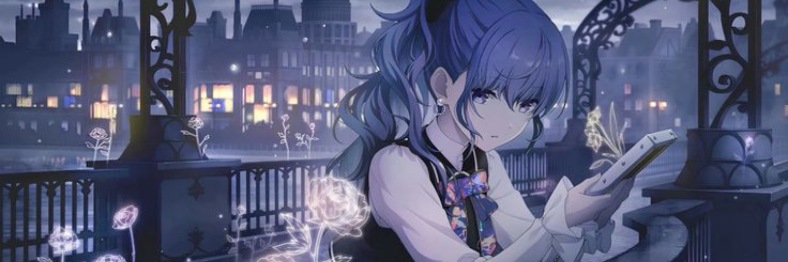
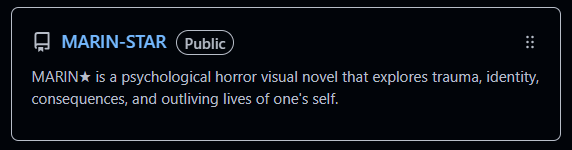
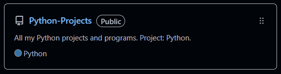
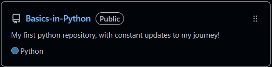

<!-- ✦ NIGHTCORD PROFILE LAYOUT ✦ -->

<!-- HEADER -->
<p align="center">
  
</p>


</p>

<p align="center">
  
</p>

<p align="center">
  <sub>☾ ２５時、ナイトコードで。 ✦ 25:00 ✦</sub>
</p>

<h1 align="center">
  FRITZ ANDERSON
</h1>

<p align="center">
  
</p>

<p align="center">
  <i>「 眠れない夜に、音楽を。 」</i>
  <br>
  <sub>Nightcord at 25:00. ♡</sub>
</p>

<!-- DIVIDER -->
<p align="center">
  
</p>

<!-- ABOUT ME -->
<h2 align="center">☾ ABOUT ME</h2>

<p align="center">
  <sub>୨ৎ A little introduction to myself ୨ৎ</sub>
</p>

```text
⋆｡°✩ user: fritxfloriann
⋆｡°✩ interests: hardware, programming, writing, gaming
⋆｡°✩ status: steady pace
⋆｡°✩ mood: always hungry

୨ৎ currently coding in Python.
୨ৎ aspiring C++ programmer.
୨ৎ technology enthusiast.
୨ৎ Mafuyu Asahina enthusiast.
```

<p align="center">
  <sub>「 I wonder what I really want to do... 」</sub>
</p>

<!-- SKILLS -->

<h2 align="center">✦ SKILLS & EXPERTISE</h2>

<p align="center">
  <sub>Understanding technology, one step at a time.</sub>
</p>

### ☾ Computer Hardware

Understanding computer components, PC building, repairs, diagnostics, troubleshooting and hardware maintenance.

### ☾ Computer Systems

Configuring operating systems, system files, networking fundamentals and resolving software conflicts.

### ☾ Programming

Learning Python, developing projects, writing maintainable code and exploring software development.

### ☾ Documentation & Development

Building structured repositories with clear documentation, commits, explanations and project organisation.

<!-- TECH STACK -->

<h2 align="center">✦ TECH STACK</h2>

<p align="center">
  
</p>

<p align="center">
  <sub>Currently learning Python. C++ is next.</sub>
</p>

<!-- REPOSITORIES -->

<h2 align="center">☾ REPOSITORIES</h2>

<p align="center">
  <sub>୨ৎ Projects, experiments and things I've built ୨ৎ</sub>
</p>

<p align="center">
  
</p>

<p align="center">
  <b>MARIN-STAR</b>
  <br>
  <a href="https://github.com/fritxfloriann/MARIN-STAR">
    Explore Repository
  </a>
  <br>
  <sub>A psychological horror visual novel adaptation.</sub>
</p>

<p align="center">
  ────────────୨ৎ────────────
</p>

<p align="center">
  
</p>

<p align="center">
  <b>Python-Projects</b>
  <br>
  <a href="https://github.com/fritxfloriann/Python-Projects">
    Explore Repository
  </a>
  <br>
  <sub>Programs, experiments and Python projects.</sub>
</p>

<p align="center">
  ────────────୨ৎ────────────
</p>

<p align="center">
  
</p>

<p align="center">
  <b>Basics-in-Python</b>
  <br>
  <a href="https://github.com/fritxfloriann/Basics-in-Python">
    Explore Repository
  </a>
  <br>
  <sub>Where my Python journey began.</sub>
</p>

<!-- GITHUB STATISTICS -->

<h2 align="center">✦ GITHUB STATISTICS</h2>

<p align="center">
  
</p>

<!-- CONNECT -->

<h2 align="center">☾ FIND ME ELSEWHERE</h2>

<p align="center">
  <a href="https://github.com/fritxfloriann">
    
  </a>

  <a href="https://linktr.ee/unstxbleflxr1a">
    
  </a>
</p>

<!-- FOOTER -->

<p align="center">
  ୨୧ ───────────────────── ୨୧
  <br><br>
  <i>「 25:00 — a world of our own. 」</i>
  <br><br>
  <sub>Thanks for visiting my GitHub profile. ❄️</sub>
</p>


</p>

<p align="center">
  
</p>

<!-- END -->
